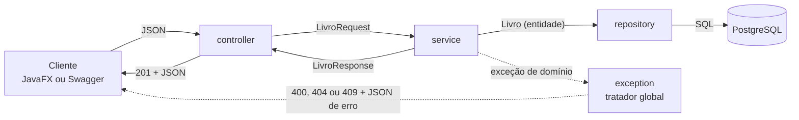

# Arquitetura e convenções do backend

> **Definida na Issue #9.** Como o backend é organizado em camadas e as convenções que os dois integrantes seguem nos CRUDs: nomes, DTOs, conversão entre entidade e DTO, validação, erros e transações. As rotas e os códigos HTTP estão no [contrato da API](MODELAGEM.md#contrato-inicial-da-api-proposta); aqui fica *como* o código é escrito. Mudanças nestas regras entram por PR.

## Camadas

Cada camada é um pacote de `br.com.classbook`, com um `package-info.java` que resume o seu papel.

| Pacote | Responsabilidade | Não faz |
| --- | --- | --- |
| `controller` | Recebe a requisição HTTP, valida o corpo com `@Valid`, chama o service e monta a resposta (status e `Location`). | Regra de negócio, acesso a repositório, `try/catch` para montar erro. |
| `service` | Regras de negócio, transações e conversão entre entidade e DTO. Lança as exceções de domínio. | Nada de HTTP: não usa `ResponseEntity`, `HttpStatus` nem dados da requisição. |
| `repository` | Interfaces Spring Data JPA: buscar, salvar e excluir, e consultas como `existsByIsbn`. | Regra de negócio. |
| `model` | Entidades JPA, mapeadas para as tabelas das migrations, e os enums do domínio. | Aparecer na API. |
| `dto` | Records de entrada (`Request`) e de saída (`Response`): o formato do JSON da API. | Regra de negócio. Só normaliza a entrada e monta o `Response` a partir da entidade. |
| `exception` | Exceções de domínio e o tratador global, que as transforma em resposta de erro. | Regra de negócio. |
| `config` | Classes `@Configuration` (por exemplo, o Swagger, Issue #47). | Regra de negócio. |

**Sentido das dependências:** `controller → service → repository → model`. O controller injeta services, nunca repositórios; o service injeta repositórios, nunca controllers. `dto` e `exception` são usados pelo controller e pelo service, e `model` não depende de nenhum outro pacote do projeto.

**Um service pode usar o repositório de outra entidade** para conferir uma referência: `LivroService` usa `AutorRepository` para achar o autor de `autorId`, e `AutorService` usa `LivroRepository` para saber se o autor tem livros antes de excluir (ver [Regras comuns às relações](MODELAGEM.md#regras-comuns-às-relações)). Um service não chama outro service: assim não surgem dependências circulares, e cada um trabalha com entidades, não com o `Response` do outro.

### O caminho de uma requisição



Um `POST /api/livros`, passo a passo:

1. **controller:** o Jackson converte o JSON em `LivroRequest`. O construtor do record normaliza o ISBN e o `@Valid` confere o formato de cada campo. Se algum campo for inválido, a resposta é `400` e o service nem é chamado.
2. **service:** dentro de uma transação, confere o que depende do banco (ISBN já usado: `409`; `autorId` inexistente: `400`), monta a entidade `Livro` e pede ao repositório para salvá-la.
3. **repository:** o Spring Data executa o `INSERT`, e o banco gera o `id`.
4. **service:** converte a entidade salva em `LivroResponse`, ainda dentro da transação.
5. **controller:** responde `201 Created`, com o cabeçalho `Location` (`/api/livros/{id}`) e o `LivroResponse` no corpo.

Se o service lança uma exceção, a transação é desfeita e o tratador global responde o erro (ver [Erros e exceções](#erros-e-exceções)).

## Nomes

| O quê | Padrão | Exemplo |
| --- | --- | --- |
| Entidade | nome do domínio, no singular | `Autor`, `MaterialDigital` |
| Enum | nome do conceito | `TipoCategoria`, `SerieEscolar`, `FormatoMaterial` |
| Repository | `<Entidade>Repository` | `AutorRepository` |
| Service | `<Entidade>Service` | `AutorService` |
| Controller | `<Entidade>Controller` | `AutorController` |
| DTO de entrada | `<Entidade>Request` | `AutorRequest` |
| DTO de saída | `<Entidade>Response` | `AutorResponse` |
| Resumo aninhado | `<Entidade>Resumo`, record interno do `Response` que o usa | `LivroResponse.AutorResumo` |
| Exceção | descreve o problema e termina em `Exception` | `RecursoNaoEncontradoException` |
| Configuração | `<Assunto>Config` | `OpenApiConfig` |
| Teste | `<ClasseTestada>Tests`, no mesmo pacote da classe testada | `AutorServiceTests` |
| Rota | `/api/<recurso no plural>`, em minúsculas | `/api/autores`, `/api/materiais` |

- **Domínio em português, sufixos técnicos em inglês.** Classes, campos, métodos e mensagens ficam em português (RNF09), sem acentos nos identificadores (`MaterialDigital`, `serieEscolar`). Os sufixos seguem o Spring: `Repository`, `Service`, `Controller`, `Request`, `Response`, `Exception` e `Config`.
- **Consultas derivadas do Spring Data** começam pelas palavras-chave em inglês, porque o Spring Data monta a consulta a partir delas: `existsByIsbn`, `existsByAutorId`, `existsByNomeIgnoreCase`.
- **Métodos do service e do controller:** `criar`, `listar`, `buscarPorId`, `atualizar` e `excluir`, com os mesmos nomes nas duas camadas.
- **JSON:** os campos têm o nome dos componentes do record, em camelCase (`anoPublicacao`, `autorId`), e os enums trafegam pelo nome da constante (`"PRIMEIRA_SERIE"`).

## Entidades

- **Classes comuns**, com construtor sem argumentos, getters e setters (o JPA não aceita records como entidade). O projeto não usa Lombok.
- **Nomes de tabela e de coluna** saem do nome da classe e do campo, convertidos para `snake_case` pelo Spring Boot: `MaterialDigital` vira `material_digital` e `dataNascimento` vira `data_nascimento`. Por isso `@Table` e `@Column(name = ...)` só são necessários quando o nome for diferente. Com `ddl-auto=validate`, um nome que não bate com a migration impede a aplicação de iniciar.
- **ID:** `@Id @GeneratedValue(strategy = GenerationType.IDENTITY)`, que corresponde ao `GENERATED ALWAYS AS IDENTITY` das tabelas.
- **Enums** com `@Enumerated(EnumType.STRING)` e **relacionamentos** como definidos na [modelagem](MODELAGEM.md#relacionamentos): `@ManyToOne(fetch = LAZY)`, unidirecionais e sem `cascade`.
- **Sem Bean Validation na entidade.** As regras de entrada ficam no `Request` ([Validação](#validação)), e as restrições da migration (`NOT NULL`, `UNIQUE`, chaves estrangeiras) são a rede de segurança.

## DTOs

- **Records Java** em `dto/`: imutáveis e sem setters. O Jackson cria e serializa records sem nenhuma configuração.
- **Um `Request` para `POST` e `PUT`.** O `PUT` substitui o registro inteiro ([contrato](MODELAGEM.md#livros-e-autores)), então os campos são os mesmos. O `Request` não tem `id`: o ID vem da rota (`/api/livros/{id}`), e um `id` enviado no corpo é ignorado.
- **Um `Response` para todas as saídas do recurso** (cadastro, edição, consulta e listagem): o `id` e os campos, sem dados internos.
- **Relacionamentos:** o `Request` recebe o ID (`autorId`, `categoriaId`, `disciplinaId`), e o `Response` devolve um resumo aninhado (`autor: {id, nome}`), declarado como record interno do `Response` que o usa.
- **Enums:** os DTOs usam os próprios enums de `model` (`TipoCategoria tipo`). O Jackson converte pelo nome exato da constante e responde `400` a um valor fora da lista ou com outra caixa (`"pdf"`), sem código nosso.
- **A entidade nunca sai da API** (RNF03), nem dentro de outro DTO. O `Response` tem um método estático `de(entidade)` que copia os campos ([Services](#services)).

```java
public record LivroRequest(
        @NotBlank @Size(max = 200) String titulo,
        @NotBlank @Pattern(regexp = "^(\\d{9}[\\dX]|\\d{13})$") String isbn,
        Integer anoPublicacao,
        String descricao,
        @Size(max = 120) String editora,
        @NotNull Long autorId,
        Long categoriaId) {

    public LivroRequest {
        // Roda antes do @Valid: o @Pattern confere o ISBN já sem hífens e em maiúsculas.
        isbn = isbn == null ? null : isbn.replaceAll("[-\\s]", "").toUpperCase();
    }
}
```

```java
public record LivroResponse(Long id, String titulo, String isbn, Integer anoPublicacao,
        String descricao, String editora, AutorResumo autor, CategoriaResumo categoria) {

    public record AutorResumo(Long id, String nome) {
    }

    public record CategoriaResumo(Long id, String nome) {
    }

    public static LivroResponse de(Livro livro) {
        Categoria categoria = livro.getCategoria();
        return new LivroResponse(livro.getId(), livro.getTitulo(), livro.getIsbn(),
                livro.getAnoPublicacao(), livro.getDescricao(), livro.getEditora(),
                new AutorResumo(livro.getAutor().getId(), livro.getAutor().getNome()),
                categoria == null ? null : new CategoriaResumo(categoria.getId(), categoria.getNome()));
    }
}
```

As anotações de validação de cada campo seguem as regras da [modelagem](MODELAGEM.md#entidades-e-atributos) e são completadas na Issue #42.

## Services

- **`@Service`, classe concreta,** sem interface: há uma implementação só.
- **Injeção pelo construtor,** com campos `private final` e sem `@Autowired` em campo. As dependências ficam explícitas e o service pode ser testado com `new`.
- **Recebe `Request` e IDs e devolve `Response`** (ou `List<Response>`). Nunca devolve entidade nem `null`: o que não existe vira exceção.
- **Transações só no service,** com o `@Transactional` do Spring (`org.springframework.transaction.annotation`; o `jakarta.transaction.Transactional` não tem `readOnly`): `readOnly = true` nas consultas, o padrão nas escritas. Controller e repository não declaram transações.
- **A conversão entre entidade e DTO acontece no service, dentro da transação.** Com `open-in-view=false` e associações `LAZY`, ler `livro.getAutor().getNome()` fora da transação lança `LazyInitializationException` (decisão 5 em [Decisões dos relacionamentos](MODELAGEM.md#decisões-dos-relacionamentos)).
  - **Entidade → `Response`:** `XxxResponse.de(entidade)`, chamado só pelo service.
  - **`Request` → entidade:** num método privado do service que preenche a entidade, usado no `criar` e no `atualizar`. Fica no service porque transformar `autorId` em `Autor` exige consultar o repositório e responder `400` se o autor não existir.

```java
@Service
public class LivroService {

    private final LivroRepository livroRepository;
    private final AutorRepository autorRepository;

    public LivroService(LivroRepository livroRepository, AutorRepository autorRepository) {
        this.livroRepository = livroRepository;
        this.autorRepository = autorRepository;
    }

    @Transactional
    public LivroResponse criar(LivroRequest request) {
        if (livroRepository.existsByIsbn(request.isbn())) {
            throw new ConflitoException("Já existe um livro com o ISBN " + request.isbn() + ".");
        }
        Livro livro = new Livro();
        preencher(livro, request);
        return LivroResponse.de(livroRepository.save(livro));
    }

    @Transactional(readOnly = true)
    public LivroResponse buscarPorId(Long id) {
        return livroRepository.findById(id)
                .map(LivroResponse::de)
                .orElseThrow(() -> new RecursoNaoEncontradoException("Livro " + id + " não encontrado."));
    }

    // listar, atualizar e excluir seguem o mesmo padrão

    private void preencher(Livro livro, LivroRequest request) {
        Autor autor = autorRepository.findById(request.autorId())
                .orElseThrow(() -> new DadosInvalidosException("Autor " + request.autorId() + " não existe."));
        livro.setTitulo(request.titulo());
        livro.setIsbn(request.isbn());
        // ... demais campos
        livro.setAutor(autor);
    }
}
```

## Controllers

- **`@RestController` com `@RequestMapping("/api/<recurso>")`,** seguindo as rotas e os [códigos HTTP](MODELAGEM.md#códigos-http) do contrato.
- **Injeta só o service do recurso,** pelo construtor.
- **`@Valid @RequestBody XxxRequest`** no `POST` e no `PUT`.
- **Respostas:** o `POST` devolve `ResponseEntity.created(location).body(...)` (`201` com `Location`); o `DELETE` é `void` com `@ResponseStatus(HttpStatus.NO_CONTENT)` (`204`); o `GET` e o `PUT` devolvem o `Response` direto (`200`).
- **Sem `try/catch`:** as exceções seguem para o tratador global.

```java
@RestController
@RequestMapping("/api/livros")
public class LivroController {

    private final LivroService livroService;

    public LivroController(LivroService livroService) {
        this.livroService = livroService;
    }

    @PostMapping
    public ResponseEntity<LivroResponse> criar(@Valid @RequestBody LivroRequest request) {
        LivroResponse livro = livroService.criar(request);
        URI location = ServletUriComponentsBuilder.fromCurrentRequest()
                .path("/{id}").buildAndExpand(livro.id()).toUri();
        return ResponseEntity.created(location).body(livro);
    }

    @GetMapping("/{id}")
    public LivroResponse buscarPorId(@PathVariable Long id) {
        return livroService.buscarPorId(id);
    }

    @DeleteMapping("/{id}")
    @ResponseStatus(HttpStatus.NO_CONTENT)
    public void excluir(@PathVariable Long id) {
        livroService.excluir(id);
    }
}
```

## Validação

A validação acontece em dois lugares, conforme a regra precise ou não do banco:

| Onde | O que confere | Exemplos | Resposta |
| --- | --- | --- | --- |
| `Request`, com Bean Validation e `@Valid` no controller | O formato de cada campo, sem consultar o banco | Obrigatório (`@NotBlank`, `@NotNull`), tamanho máximo igual ao da coluna (`@Size`), formato do ISBN (`@Pattern`), URL http/https, data no passado (`@Past`) | `400`, antes de chegar ao service |
| `service` | O que depende do banco ou não cabe numa anotação | ISBN, nome de categoria ou código de disciplina já usados; `autorId`, `categoriaId` ou `disciplinaId` inexistente; registro em uso na exclusão; ano de publicação no futuro | Exceção de domínio (`400` ou `409`) |

- **A normalização da entrada fica no construtor compacto do `Request`:** tirar hífens e espaços do ISBN e passá-lo para maiúsculas, tirar os espaços das pontas do nome da categoria, deixar o código da disciplina sem espaços nas pontas e em maiúsculas. Ele roda antes do `@Valid`, então a validação, o service e o banco recebem o valor já normalizado (exemplo em [DTOs](#dtos)).
- **As mensagens de validação ficam em português,** em `src/main/resources/ValidationMessages.properties`, e chegam ao cliente no campo `campos` do [formato de erro](#formato-de-erro).
- **A entidade não repete as regras do `Request`** ([Entidades](#entidades)).

## Erros e exceções

O service lança exceções de domínio, e o controller não as trata. O tratador global (`TratadorGlobalDeExcecoes`, um `@RestControllerAdvice` em `exception`, Issue #43) as transforma em resposta HTTP, no formato padronizado na Issue #44, com mensagem em português e sem stack trace.

### Formato de erro

Todo erro da API sai como `ErroResponse`, com os mesmos campos em todas as rotas:

```json
{
  "horario": "2026-11-01T03:07:19.637Z",
  "status": 400,
  "erro": "Requisição inválida",
  "mensagem": "Há campos inválidos na requisição.",
  "caminho": "/api/autores",
  "campos": [
    { "campo": "nome", "mensagem": "é obrigatório e não pode ficar em branco" }
  ]
}
```

- `erro` é a descrição curta do status, em português, e `mensagem` explica o caso: a mensagem da exceção de domínio ou um texto fixo para os erros do Spring.
- `campos` lista os campos inválidos de um `400` (do `@Valid`, de um enum fora da lista ou de um valor com tipo errado) e vem vazio nos demais erros.
- O `500` nunca mostra a mensagem da exceção: ela vai só para o log.

| Exceção (pacote `exception`) | Status | Quando |
| --- | --- | --- |
| `RecursoNaoEncontradoException` | `404` | O `{id}` da rota não existe. |
| `DadosInvalidosException` | `400` | Regra de entrada conferida no service: `autorId`, `categoriaId` ou `disciplinaId` inexistente, ano de publicação no futuro. |
| `ConflitoException` | `409` | Duplicidade (ISBN, nome de categoria, código de disciplina) ou exclusão de um registro ainda referenciado. |

As três estendem `RuntimeException`, com um construtor que recebe a mensagem. Por não serem verificadas, não precisam aparecer na assinatura de cada método, e o Spring desfaz a transação quando uma delas é lançada.

O tratador global também cobre erros que o próprio Spring lança, sem exceção nossa:

| Situação | Exceção | Status |
| --- | --- | --- |
| Campo inválido no `Request` (`@Valid`) | `MethodArgumentNotValidException` | `400`, listando os campos com erro |
| JSON malformado ou enum fora da lista | `HttpMessageNotReadableException` | `400` |
| Filtro que não é número (`?autorId=abc`) | `MethodArgumentTypeMismatchException` | `400` |
| Restrição do banco violada que escapou do service | `DataIntegrityViolationException` | `409`, sem detalhes do banco |
| Rota inexistente, método não suportado, corpo que não é JSON | `NoResourceFoundException`, `HttpRequestMethodNotSupportedException`, `HttpMediaTypeNotSupportedException` | `404`, `405`, `415` |
| Qualquer outro erro | `Exception` | `500`, com mensagem genérica |

**Quem cria as exceções:** os nomes ficam combinados aqui para as duas frentes usarem as mesmas classes. Cada exceção é criada pela primeira Issue que precisar dela (`RecursoNaoEncontradoException`, por exemplo, já no primeiro service, #13 ou #31), sem mudar o nome. As exceções não carregam status HTTP (sem `@ResponseStatus`): quem decide o código é o tratador global, criado na #43. Os testes dos services conferem a exceção lançada, e os dos controllers, o status e o corpo.

## Checklist de revisão

Ao revisar um PR de CRUD, confira:

- O controller injeta só o service, não tem regra de negócio nem `try/catch`, e responde `201` com `Location` no cadastro e `204` na exclusão.
- Nenhuma entidade é recebida ou devolvida pela API: o controller só vê `Request` e `Response`.
- A conversão para `Response` acontece dentro de um método `@Transactional` do service.
- As regras de formato estão no `Request` (com `@Valid` no controller), e as que dependem do banco, no service.
- Erros saem como as exceções de `exception`, nunca como `null` ou como uma resposta de erro montada no controller.
- Os nomes de classes, métodos e rotas seguem a tabela de [Nomes](#nomes).
