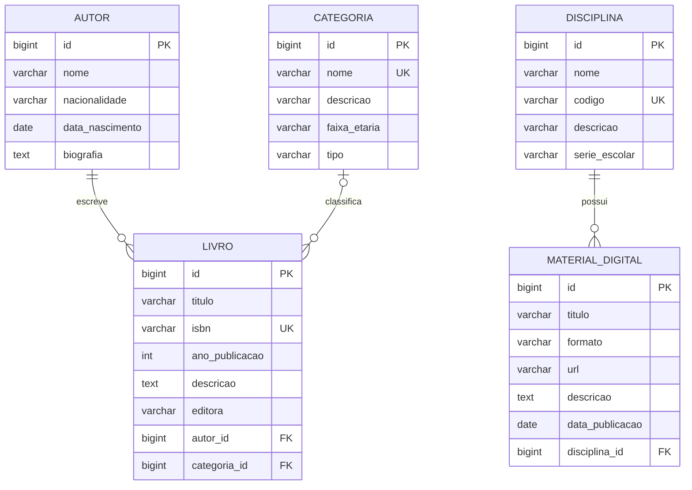

# Modelagem do ClassBook

> **Revisada nas Issues #3 e #4.** As cinco entidades foram revisadas e as decisões estão em [Decisões da revisão conjunta](#decisões-da-revisão-conjunta). Os três relacionamentos e o contrato inicial da API estão definidos (ver [Decisões dos relacionamentos](#decisões-dos-relacionamentos)). As tabelas são criadas pela migration inicial, [`V1__criar_tabelas_iniciais.sql`](../src/main/resources/db/migration/V1__criar_tabelas_iniciais.sql) (Issue #8); as entidades JPA ainda não foram criadas.

## Entidades e atributos

Cada entidade tem pelo menos quatro atributos além do ID, como exige a disciplina. Chaves estrangeiras não entram nessa contagem.

Convenções: IDs `BIGINT` gerados pelo PostgreSQL (`GENERATED ALWAYS AS IDENTITY`); tabelas e colunas em `snake_case`, tabelas no singular.

Restrições e índices têm nome explícito, para que a mensagem de erro do banco diga qual regra foi violada (útil no tratamento do `409`, Issue #46):

| Nome | Tabela | Regra |
| --- | --- | --- |
| `uk_livro_isbn` | `livro` | `UNIQUE (isbn)` |
| `uk_categoria_nome` | `categoria` | índice único em `LOWER(nome)` |
| `uk_disciplina_codigo` | `disciplina` | `UNIQUE (codigo)` |
| `fk_livro_autor` | `livro` | `autor_id` → `autor`, `ON DELETE RESTRICT` |
| `fk_livro_categoria` | `livro` | `categoria_id` → `categoria`, `ON DELETE RESTRICT` |
| `fk_material_digital_disciplina` | `material_digital` | `disciplina_id` → `disciplina`, `ON DELETE RESTRICT` |

Cada chave estrangeira também tem um índice (`idx_livro_autor_id`, `idx_livro_categoria_id`, `idx_material_digital_disciplina_id`), porque o PostgreSQL não cria um automaticamente. Eles servem aos filtros da pesquisa de livros e à verificação de registro em uso antes de uma exclusão.

### Autor (`autor`)

| Atributo | Tipo Java | Coluna | Regras propostas |
| --- | --- | --- | --- |
| id | Long | `id` | PK |
| nome | String | `nome VARCHAR(150)` | obrigatório |
| nacionalidade | String | `nacionalidade VARCHAR(80)` | opcional |
| dataNascimento | LocalDate | `data_nascimento DATE` | opcional; no passado |
| biografia | String | `biografia TEXT` | opcional |

Nome **não** é único (homônimos existem).

### Livro (`livro`)

| Atributo | Tipo Java | Coluna | Regras propostas |
| --- | --- | --- | --- |
| id | Long | `id` | PK |
| titulo | String | `titulo VARCHAR(200)` | obrigatório |
| isbn | String | `isbn VARCHAR(13)` | obrigatório, **único**, guardado sem hífens nem espaços, em maiúsculas (10 ou 13 caracteres; só o ISBN-10 pode terminar em `X`) |
| anoPublicacao | Integer | `ano_publicacao INTEGER` | opcional; não pode ser futuro |
| descricao | String | `descricao TEXT` | opcional |
| editora | String | `editora VARCHAR(120)` | opcional |
| autor | Autor | `autor_id BIGINT` | **obrigatório**, FK para `autor` |
| categoria | Categoria | `categoria_id BIGINT` | **opcional**, FK para `categoria` |

Sobre o ISBN:

- O valor recebido é normalizado (remove hífens e espaços, converte para maiúsculas) e validado pelo formato `^(\d{9}[\dX]|\d{13})$`. O dígito verificador **não** é conferido, para manter o escopo simples.
- A unicidade vale para o texto guardado: o mesmo livro cadastrado uma vez com ISBN-10 e outra com ISBN-13 não é detectado como duplicado.
- O tratamento do erro de duplicidade (409) é implementado na Issue #46.

O ano de publicação "não futuro" não cabe numa anotação do Bean Validation para `Integer`; a regra é conferida no `service` (ou em um validador próprio).

### Categoria (`categoria`)

| Atributo | Tipo Java | Coluna | Regras propostas |
| --- | --- | --- | --- |
| id | Long | `id` | PK |
| nome | String | `nome VARCHAR(100)` | obrigatório, **único** sem diferenciar maiúsculas de minúsculas (ver *Unicidade*) |
| descricao | String | `descricao VARCHAR(500)` | opcional |
| faixaEtaria | String | `faixa_etaria VARCHAR(30)` | opcional; texto livre (ex.: "14 a 17 anos", "Livre") |
| tipo | enum `TipoCategoria` | `tipo VARCHAR(30)` | obrigatório; valores: `DIDATICO`, `PARADIDATICO`, `LITERATURA`, `REFERENCIA`, `OUTRO` |

### Disciplina (`disciplina`)

| Atributo | Tipo Java | Coluna | Regras propostas |
| --- | --- | --- | --- |
| id | Long | `id` | PK |
| nome | String | `nome VARCHAR(100)` | obrigatório; **não** é único (a mesma disciplina pode existir em séries diferentes, com códigos diferentes) |
| codigo | String | `codigo VARCHAR(20)` | obrigatório, **único**; guardado sem espaços nas pontas e em maiúsculas (ver *Unicidade*) |
| descricao | String | `descricao VARCHAR(500)` | opcional |
| serieEscolar | enum `SerieEscolar` | `serie_escolar VARCHAR(30)` | obrigatório; valores: `PRIMEIRA_SERIE`, `SEGUNDA_SERIE`, `TERCEIRA_SERIE` (ensino médio) |

### MaterialDigital (`material_digital`)

| Atributo | Tipo Java | Coluna | Regras propostas |
| --- | --- | --- | --- |
| id | Long | `id` | PK |
| titulo | String | `titulo VARCHAR(200)` | obrigatório; não é único |
| formato | enum `FormatoMaterial` | `formato VARCHAR(20)` | obrigatório; valores: `PDF`, `EPUB`, `VIDEO`, `AUDIO`, `LINK`, `OUTRO` |
| url | String | `url VARCHAR(500)` | obrigatório; URL http/https válida |
| descricao | String | `descricao TEXT` | opcional |
| dataPublicacao | LocalDate | `data_publicacao DATE` | opcional |
| disciplina | Disciplina | `disciplina_id BIGINT` | **obrigatório**, FK para `disciplina` |

### Enums e unicidade

Os valores fechados (`tipo`, `formato` e `serieEscolar`) são **enums Java** em `model/`, guardados como texto com `@Enumerated(EnumType.STRING)`. Um valor fora da lista é rejeitado com `400` (a ser tratado no tratamento global de erros, Issue #43), e a interface JavaFX os escolhe em uma lista. Não há `CHECK` no banco, para a lista ter uma única fonte: o enum.

**Unicidade** (decisão 6). O tratamento do erro `409` é implementado na Issue #46:

- **Categoria.nome:** sem espaços nas pontas e comparado sem diferenciar maiúsculas de minúsculas ("Literatura" e "literatura" são a mesma categoria). Índice único em `LOWER(nome)` no banco, mais verificação no `service`.
- **Disciplina.codigo:** guardado sem espaços nas pontas e em maiúsculas, com `UNIQUE` no banco e verificação no `service`.

## Relacionamentos

| Relação | Cardinalidade | Lado dono da FK | Exclusão |
| --- | --- | --- | --- |
| Livro → Autor | muitos para um | `livro.autor_id` | `ON DELETE RESTRICT` |
| Livro → Categoria | muitos para um (opcional) | `livro.categoria_id` | `ON DELETE RESTRICT` |
| MaterialDigital → Disciplina | muitos para um | `material_digital.disciplina_id` | `ON DELETE RESTRICT` |

Excluir um autor, categoria ou disciplina que ainda é referenciado deve responder **409 Conflict**, tratado no `service` e protegido pela FK no banco.

### Livro → Autor

| Aspecto | Definição |
| --- | --- |
| Cardinalidade | N:1. Um livro tem exatamente um autor; um autor pode ter vários livros. |
| Lado dono da FK | `livro.autor_id` |
| Nulabilidade | `NOT NULL`: todo livro tem autor. |
| Exclusão | `ON DELETE RESTRICT`: um autor com livros não é excluído (`409`). Excluir um livro não afeta o autor. |
| Mapeamento JPA | `@ManyToOne(fetch = LAZY, optional = false)` com `@JoinColumn(name = "autor_id", nullable = false)`. Unidirecional e sem `cascade`: `Autor` não tem lista de livros. |
| API | Entrada: `autorId` (obrigatório). Saída: `autor: {id, nome}`. |

### Livro → Categoria

| Aspecto | Definição |
| --- | --- |
| Cardinalidade | N:1 opcional. Um livro tem no máximo uma categoria; uma categoria pode ter vários livros. |
| Lado dono da FK | `livro.categoria_id` |
| Nulabilidade | Aceita `NULL`: o livro pode não ter categoria. |
| Exclusão | `ON DELETE RESTRICT`: uma categoria com livros não é excluída (`409`). |
| Mapeamento JPA | `@ManyToOne(fetch = LAZY)` com `@JoinColumn(name = "categoria_id")`. Unidirecional e sem `cascade`. |
| API | Entrada: `categoriaId` (opcional). Saída: `categoria: {id, nome}`, ou `null` quando o livro não tem categoria. |

### MaterialDigital → Disciplina

| Aspecto | Definição |
| --- | --- |
| Cardinalidade | N:1. Um material pertence a exatamente uma disciplina; uma disciplina pode ter vários materiais ou nenhum. |
| Lado dono da FK | `material_digital.disciplina_id` |
| Nulabilidade | `NOT NULL`: todo material tem disciplina. |
| Exclusão | `ON DELETE RESTRICT`: uma disciplina com materiais não é excluída (`409`). Excluir um material não afeta a disciplina. |
| Mapeamento JPA | `@ManyToOne(fetch = LAZY, optional = false)` com `@JoinColumn(name = "disciplina_id", nullable = false)`. Unidirecional e sem `cascade`: `Disciplina` não tem lista de materiais. |
| Carregamento | A listagem de materiais carrega a disciplina na mesma consulta (`@EntityGraph(attributePaths = "disciplina")` ou `JOIN FETCH`). Aqui o `JOIN` simples serve, porque a disciplina é obrigatória. |
| API | Entrada: `disciplinaId` (obrigatório). Saída: `disciplina: {id, nome, codigo}`. O `codigo` entra no resumo porque o nome da disciplina não é único (a mesma disciplina existe em séries diferentes). |

### Regras comuns às relações

- **Excluir um registro em uso:** como o lado "um" não guarda lista, o `service` consulta o repositório do lado "muitos" (por exemplo, `LivroRepository.existsByAutorId`) e responde `409` antes de tentar excluir. A FK com `RESTRICT` é a rede de segurança: se a violação de integridade chegar ao tratador global, também vira `409`, nunca `500`.
- **Referência inexistente no corpo** (`autorId`, `categoriaId`, `disciplinaId`): responde `400` com mensagem clara (decisão 2 em [Decisões dos relacionamentos](#decisões-dos-relacionamentos)).
- **`LAZY` com `open-in-view=false`:** a associação só pode ser lida dentro da transação. O `service` converte a entidade em DTO dentro do método `@Transactional`, nunca no controller, e a listagem e a pesquisa carregam autor e categoria na mesma consulta (`@EntityGraph(attributePaths = {"autor", "categoria"})` ou `LEFT JOIN FETCH`), para não gerar uma consulta extra por livro. Como a categoria é opcional, o `fetch` precisa ser `LEFT`: um `JOIN FETCH` simples esconderia os livros sem categoria.
- **O que o Hibernate valida:** com `ddl-auto=validate`, ele confere tabelas e colunas, mas não `NOT NULL`, `UNIQUE`, chave estrangeira nem `ON DELETE`. Essas regras estão declaradas na migration inicial e são conferidas pelo teste `MigrationInicialTests`.

## Diagrama ER



## Justificativas das decisões

- **Relacionamentos unidirecionais, só no lado "muitos".** `Livro` conhece `Autor`, mas `Autor` não guarda uma lista de livros. Isso evita recursão infinita na serialização JSON, carregamentos desnecessários e código a mais. A consulta "livros de um autor" é feita por query no repositório.
- **`@ManyToOne(fetch = LAZY)`** em todas as associações, para não carregar dados que ninguém pediu.
- **DTOs na entrada e na saída.** As entidades nunca são expostas pela API. Os DTOs são *records* Java em `dto/`, `XxxRequest` na entrada e `XxxResponse` na saída, como combinado na Issue #9 (ver [ARQUITETURA](ARQUITETURA.md#dtos)). As respostas de `Livro` trazem resumos aninhados (`autor: {id, nome}`, `categoria: {id, nome}`), e as de `MaterialDigital` trazem `disciplina: {id, nome, codigo}` (o `codigo` desambigua disciplinas de mesmo nome).
- **Um autor por livro.** Atende ao requisito "relacionamento com Autor" com o menor custo. Coautoria exigiria a tabela `livro_autor` e mudaria a API e a interface; fica fora desta versão (decidido na Issue #3, ver [Limitações assumidas](REQUISITOS.md#limitações-assumidas)).
- **Categoria opcional em Livro.** Reduz o acoplamento entre as duas frentes de trabalho: o CRUD de Livro funciona sem esperar o CRUD de Categoria. A associação é ligada na Issue #26, que depende explicitamente das Issues #30 e #31.
- **Schema só por Flyway.** A pasta `db/migration` é a fonte da verdade e o Hibernate roda com `ddl-auto=validate`. A migration inicial cria as cinco tabelas já revisadas; mudanças posteriores entram em novas migrations (ver [CONTRIBUTING](../CONTRIBUTING.md#migrations-flyway)).
- **Unicidade onde há regra de negócio:** ISBN, código da disciplina e nome da categoria. Nome de autor não, por haver homônimos, e nome de disciplina também não, porque a mesma disciplina pode existir em séries diferentes.
- **Enums Java para listas fechadas** (`tipo`, `formato`, `serieEscolar`): evitam erros de digitação e viram lista de seleção na interface. Texto livre exigiria validar a mesma lista em vários lugares. O custo é que um valor novo exige alterar o código, o que o valor `OUTRO` ameniza em `tipo` e `formato`.
- **Sem campos de auditoria** (data de criação, usuário) e sem vínculo direto entre `Livro` e `MaterialDigital`, para manter o escopo acadêmico e dentro dos requisitos.

## Contrato inicial da API (proposta)

Serve para o backend e a interface JavaFX avançarem em paralelo. Validado na Issue #4 para os cinco recursos. Será documentado no Swagger.

| Recurso | Rotas |
| --- | --- |
| Autor | `GET/POST /api/autores`, `GET/PUT/DELETE /api/autores/{id}` |
| Livro | `GET/POST /api/livros`, `GET/PUT/DELETE /api/livros/{id}` |
| Categoria | `GET/POST /api/categorias`, `GET/PUT/DELETE /api/categorias/{id}` |
| Disciplina | `GET/POST /api/disciplinas`, `GET/PUT/DELETE /api/disciplinas/{id}` |
| MaterialDigital | `GET/POST /api/materiais`, `GET/PUT/DELETE /api/materiais/{id}` |

- **Pesquisa avançada:** `GET /api/livros?titulo=&autorId=&categoriaId=` (filtros opcionais e combináveis; o filtro de autor usa só o ID). Detalhes em [Livros e autores](#livros-e-autores).
- **Códigos HTTP:** `200` (consulta, edição), `201` com `Location` (cadastro), `204` (exclusão), `400` (dados inválidos), `404` (ID da rota inexistente), `409` (duplicidade ou registro em uso). O que cada operação pode devolver está na tabela abaixo.

### Códigos HTTP

| Operação | Sucesso | Erros possíveis |
| --- | --- | --- |
| `GET /api/<recurso>` | `200` com a lista (vazia se não houver registros) | `400` (filtro inválido; só na pesquisa de livros) |
| `GET /api/<recurso>/{id}` | `200` | `404` |
| `POST /api/<recurso>` | `201` com `Location` e o registro criado no corpo | `400`, `409` |
| `PUT /api/<recurso>/{id}` | `200` com o registro atualizado | `400`, `404`, `409` |
| `DELETE /api/<recurso>/{id}` | `204`, sem corpo | `404`, `409` |

| Código | Quando |
| --- | --- |
| `400` | Corpo ou parâmetro inválido: campo obrigatório ausente, valor fora da regra, valor de enum fora da lista, filtro que não é número, ou ID de autor, categoria ou disciplina que não existe. |
| `404` | O `{id}` da própria rota não existe. |
| `409` | Duplicidade (ISBN, nome de categoria, código de disciplina) ou exclusão de um registro ainda referenciado. |

### Livros e autores

Corpo de `LivroRequest` (entrada de `POST` e `PUT`):

```json
{
  "titulo": "Livro de exemplo",
  "isbn": "978-0-306-40615-7",
  "anoPublicacao": 2020,
  "descricao": "Texto opcional",
  "editora": "Editora Exemplo",
  "autorId": 1,
  "categoriaId": 2
}
```

`LivroResponse` (saída de todas as rotas de livro): os IDs viram resumos aninhados e o ISBN volta normalizado.

```json
{
  "id": 7,
  "titulo": "Livro de exemplo",
  "isbn": "9780306406157",
  "anoPublicacao": 2020,
  "descricao": "Texto opcional",
  "editora": "Editora Exemplo",
  "autor": { "id": 1, "nome": "Autor Exemplo" },
  "categoria": { "id": 2, "nome": "Literatura" }
}
```

- **`PUT` substitui o registro inteiro.** Campo opcional ausente ou `null` limpa o valor; um `PUT` sem `categoriaId` remove a categoria do livro. `autorId` ausente responde `400`.
- **Campos opcionais sem valor** vêm como `null` na resposta (`anoPublicacao`, `descricao`, `editora`, `categoria`).
- **Pesquisa em `GET /api/livros`:**
  - `titulo`: contém o texto, sem diferenciar maiúsculas de minúsculas; vazio ou em branco equivale a não informar.
  - `autorId` e `categoriaId`: IDs numéricos. Um ID que não existe não é erro: a resposta é `200` com lista vazia. Valor que não é número responde `400`.
  - Filtros informados juntos precisam ser todos satisfeitos (E lógico). Sem filtros, devolve todos os livros, ordenados por título.
  - Livros sem categoria só aparecem quando o filtro de categoria não é usado.
- **Erros específicos de livros e autores:**

| Rota | Código | Causa |
| --- | --- | --- |
| `POST /api/livros`, `PUT /api/livros/{id}` | `400` | `autorId` ausente ou inexistente; `categoriaId` informado e inexistente; demais campos inválidos |
| `POST /api/livros`, `PUT /api/livros/{id}` | `409` | ISBN já cadastrado em outro livro |
| `GET`, `PUT` e `DELETE /api/livros/{id}` | `404` | livro inexistente |
| `DELETE /api/autores/{id}` | `409` | autor com livros |

### Categoria, Disciplina e MaterialDigital

As rotas e as tabelas de códigos acima valem sem mudanças para os três recursos. Como em livros, o `PUT` substitui o registro inteiro (campo opcional ausente ou `null` limpa o valor), campos opcionais sem valor vêm como `null` na resposta e os enums trafegam pelo nome exato da constante, em maiúsculas (`"LITERATURA"`, `"PRIMEIRA_SERIE"`, `"PDF"`), nos dois sentidos: `"PDF"` sim, `"pdf"` não (responde `400`). As listagens não têm filtros (a pesquisa avançada cobre só livros) e são ordenadas: categorias por nome, disciplinas por código e materiais por título.

Corpo de `CategoriaRequest`:

```json
{
  "nome": "Literatura",
  "descricao": "Romances, contos e poesia",
  "faixaEtaria": "14 a 17 anos",
  "tipo": "LITERATURA"
}
```

Corpo de `DisciplinaRequest`:

```json
{
  "nome": "Matemática",
  "codigo": "mat-1",
  "descricao": "Matemática da 1ª série",
  "serieEscolar": "PRIMEIRA_SERIE"
}
```

O `codigo` acima volta normalizado na resposta (`"MAT-1"`). `CategoriaResponse` e `DisciplinaResponse` repetem os campos do corpo, com o `id`.

Corpo de `MaterialDigitalRequest`:

```json
{
  "titulo": "Lista de exercícios de funções",
  "formato": "PDF",
  "url": "https://exemplo.com/funcoes.pdf",
  "descricao": "Texto opcional",
  "dataPublicacao": "2026-03-10",
  "disciplinaId": 3
}
```

`MaterialDigitalResponse`: o `disciplinaId` vira um resumo aninhado.

```json
{
  "id": 12,
  "titulo": "Lista de exercícios de funções",
  "formato": "PDF",
  "url": "https://exemplo.com/funcoes.pdf",
  "descricao": "Texto opcional",
  "dataPublicacao": "2026-03-10",
  "disciplina": { "id": 3, "nome": "Matemática", "codigo": "MAT-1" }
}
```

- **Unicidade no `PUT`:** a verificação de nome de categoria e de código de disciplina ignora o próprio registro. Mudar "literatura" para "Literatura" na mesma categoria não é conflito.
- **Erros específicos de categorias, disciplinas e materiais:**

| Rota | Código | Causa |
| --- | --- | --- |
| `POST /api/categorias`, `PUT /api/categorias/{id}` | `400` | `nome` ou `tipo` ausente; `tipo` fora da lista; demais campos inválidos |
| `POST /api/categorias`, `PUT /api/categorias/{id}` | `409` | nome já usado por outra categoria (sem diferenciar maiúsculas de minúsculas) |
| `POST /api/disciplinas`, `PUT /api/disciplinas/{id}` | `400` | `nome`, `codigo` ou `serieEscolar` ausente; `serieEscolar` fora da lista; demais campos inválidos |
| `POST /api/disciplinas`, `PUT /api/disciplinas/{id}` | `409` | código já usado por outra disciplina (após a normalização) |
| `POST /api/materiais`, `PUT /api/materiais/{id}` | `400` | `disciplinaId` ausente ou inexistente; `titulo`, `formato` ou `url` ausente; `formato` fora da lista; `url` que não é http/https; demais campos inválidos |
| `GET`, `PUT` e `DELETE` em `/api/categorias/{id}`, `/api/disciplinas/{id}` e `/api/materiais/{id}` | `404` | registro da rota inexistente |
| `DELETE /api/categorias/{id}` | `409` | categoria com livros |
| `DELETE /api/disciplinas/{id}` | `409` | disciplina com materiais |

Material nunca responde `409`: não tem campo único, então cadastrar ou editar não gera duplicidade, e nada o referencia, então a exclusão não é bloqueada.

## Decisões da revisão conjunta

Respostas aos pontos em aberto da proposta (Issue #3). As decisões 1, 2, 3 e 5 dizem respeito a `Autor` e `Livro`; as decisões 4 e 6, a `Categoria`, `Disciplina` e `MaterialDigital`.

| # | Pergunta | Decisão |
| --- | --- | --- |
| 1 | Um ou vários autores por livro? | **Um.** `livro.autor_id` obrigatório. Coautoria fica fora desta versão (ver *Justificativas*). |
| 2 | Categoria obrigatória ou opcional em Livro? | **Opcional**, como já decidido na Issue #2 ([REQUISITOS](REQUISITOS.md#decisões-da-revisão-de-requisitos)). |
| 3 | ISBN obrigatório? Com ou sem hífens? | **Obrigatório e único**, guardado **sem hífens** (normalizado). Detalhes em [Livro](#livro-livro). |
| 4 | `tipo`, `formato` e `serieEscolar` como texto livre validado ou como enum Java? | **Enum Java** para os três, guardado como texto. Valores fora da lista dão `400`. Valores e justificativa em [Enums e unicidade](#enums-e-unicidade). |
| 5 | A busca por autor usa o ID, o nome ou ambos? | **Só o ID** (`autorId`). O nome do autor não é único, então uma busca por nome seria ambígua; na interface o autor é escolhido em uma lista. |
| 6 | Nome de categoria único? Código de disciplina único? | **Os dois são únicos.** O nome da categoria sem diferenciar maiúsculas de minúsculas; o código da disciplina normalizado (sem espaços nas pontas, em maiúsculas). O nome da disciplina **não** é único. Detalhes em [Enums e unicidade](#enums-e-unicidade); o RF09 e a Issue #46 seguem essa decisão. |

## Decisões dos relacionamentos

Pontos que estavam em aberto ao definir as relações e o contrato (Issue #4). As decisões 1 a 5 dizem respeito a `Livro`, `Autor` e `Categoria`; a decisão 6, a `MaterialDigital` e `Disciplina`.

| # | Pergunta | Decisão |
| --- | --- | --- |
| 1 | `ON DELETE` de Livro → Categoria, que é opcional: `RESTRICT` ou `SET NULL`? | **`RESTRICT`**, como nas outras relações. `SET NULL` tiraria a categoria de todos os livros sem aviso, e o RF10 pede bloquear a exclusão de registro em uso. Para excluir uma categoria, primeiro se reclassificam os livros. |
| 2 | `autorId` ou `categoriaId` inexistente no corpo: `400` ou `404`? | **`400`.** O recurso da rota existe; o que está inválido é um valor enviado. Com `404`, um `PUT /api/livros/5` não diria se faltou o livro ou o autor. O `404` fica só para o `{id}` da rota (Issues #25, #26 e #45). |
| 3 | O que responde a pesquisa com `autorId` ou `categoriaId` que não existe? | **`200` com lista vazia**, como qualquer filtro sem resultado (Issue #28). Valor que não é número responde `400`. |
| 4 | O que faz um `PUT` sem `categoriaId`? | **Remove a categoria.** O `PUT` é uma substituição completa; o formulário de edição envia o campo vazio para limpar a categoria. |
| 5 | Como ler `autor` e `categoria` de forma `LAZY` com `open-in-view=false`? | Converter para DTO dentro do `service` transacional e carregar as duas associações na consulta da listagem (`LEFT JOIN FETCH` ou `@EntityGraph`). Ver [Regras comuns às relações](#regras-comuns-às-relações). |
| 6 | MaterialDigital → Disciplina: `disciplinaId` inexistente também responde `400`? E os demais pontos da relação? | **`400`, seguindo a decisão 2**, com o mesmo erro padronizado de `autorId` e `categoriaId` (Issue #45). A relação é N:1, `NOT NULL`, `LAZY`, unidirecional e com **`ON DELETE RESTRICT`**: `CASCADE` apagaria todos os materiais de uma disciplina sem aviso, pelo mesmo motivo que levou a rejeitar o `SET NULL` na decisão 1. Ver [MaterialDigital → Disciplina](#materialdigital--disciplina). |
