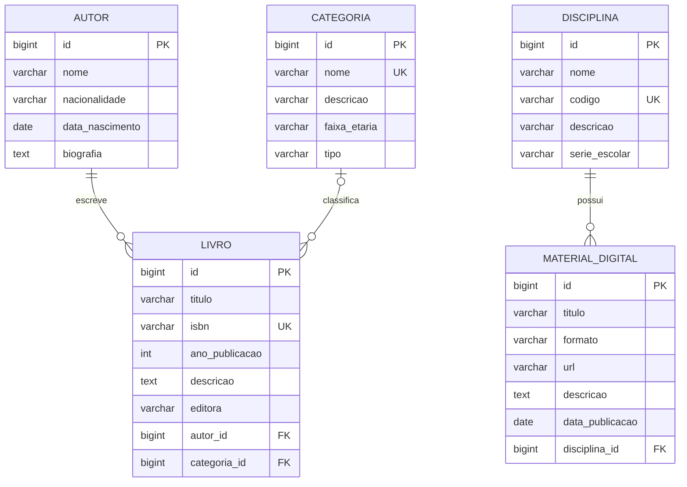

# Modelagem do ClassBook

> **Revisada na Issue #3.** As cinco entidades foram revisadas e as decisões estão em [Decisões da revisão conjunta](#decisões-da-revisão-conjunta). Os relacionamentos serão definidos na Issue #4. Nenhuma entidade, tabela ou migration foi criada ainda.

## Entidades e atributos

Cada entidade tem pelo menos quatro atributos além do ID, como exige a disciplina. Chaves estrangeiras não entram nessa contagem.

Convenções: IDs `BIGINT` gerados pelo PostgreSQL (`GENERATED ALWAYS AS IDENTITY`); tabelas e colunas em `snake_case`, tabelas no singular.

### Autor (`autor`)

| Atributo | Tipo Java | Coluna | Regras propostas |
| --- | --- | --- | --- |
| id | Long | `id` | PK |
| nome | String | `nome VARCHAR(150)` | obrigatório |
| nacionalidade | String | `nacionalidade VARCHAR(80)` | opcional |
| dataNascimento | LocalDate | `data_nascimento DATE` | opcional; no passado |
| biografia | String | `biografia TEXT` | opcional |

Nome **não** é único (homônimos existem).

### Livro (`livro`)

| Atributo | Tipo Java | Coluna | Regras propostas |
| --- | --- | --- | --- |
| id | Long | `id` | PK |
| titulo | String | `titulo VARCHAR(200)` | obrigatório |
| isbn | String | `isbn VARCHAR(13)` | obrigatório, **único**, guardado sem hífens nem espaços, em maiúsculas (10 ou 13 caracteres; só o ISBN-10 pode terminar em `X`) |
| anoPublicacao | Integer | `ano_publicacao INTEGER` | opcional; não pode ser futuro |
| descricao | String | `descricao TEXT` | opcional |
| editora | String | `editora VARCHAR(120)` | opcional |
| autor | Autor | `autor_id BIGINT` | **obrigatório**, FK para `autor` |
| categoria | Categoria | `categoria_id BIGINT` | **opcional**, FK para `categoria` |

Sobre o ISBN:

- O valor recebido é normalizado (remove hífens e espaços, converte para maiúsculas) e validado pelo formato `^(\d{9}[\dX]|\d{13})$`. O dígito verificador **não** é conferido, para manter o escopo simples.
- A unicidade vale para o texto guardado: o mesmo livro cadastrado uma vez com ISBN-10 e outra com ISBN-13 não é detectado como duplicado.
- O tratamento do erro de duplicidade (409) é implementado na Issue #46.

O ano de publicação "não futuro" não cabe numa anotação do Bean Validation para `Integer`; a regra é conferida no `service` (ou em um validador próprio).

### Categoria (`categoria`)

| Atributo | Tipo Java | Coluna | Regras propostas |
| --- | --- | --- | --- |
| id | Long | `id` | PK |
| nome | String | `nome VARCHAR(100)` | obrigatório, **único** sem diferenciar maiúsculas de minúsculas (ver *Unicidade*) |
| descricao | String | `descricao VARCHAR(500)` | opcional |
| faixaEtaria | String | `faixa_etaria VARCHAR(30)` | opcional; texto livre (ex.: "14 a 17 anos", "Livre") |
| tipo | enum `TipoCategoria` | `tipo VARCHAR(30)` | obrigatório; valores: `DIDATICO`, `PARADIDATICO`, `LITERATURA`, `REFERENCIA`, `OUTRO` |

### Disciplina (`disciplina`)

| Atributo | Tipo Java | Coluna | Regras propostas |
| --- | --- | --- | --- |
| id | Long | `id` | PK |
| nome | String | `nome VARCHAR(100)` | obrigatório; **não** é único (a mesma disciplina pode existir em séries diferentes, com códigos diferentes) |
| codigo | String | `codigo VARCHAR(20)` | obrigatório, **único**; guardado sem espaços nas pontas e em maiúsculas (ver *Unicidade*) |
| descricao | String | `descricao VARCHAR(500)` | opcional |
| serieEscolar | enum `SerieEscolar` | `serie_escolar VARCHAR(30)` | obrigatório; valores: `PRIMEIRA_SERIE`, `SEGUNDA_SERIE`, `TERCEIRA_SERIE` (ensino médio) |

### MaterialDigital (`material_digital`)

| Atributo | Tipo Java | Coluna | Regras propostas |
| --- | --- | --- | --- |
| id | Long | `id` | PK |
| titulo | String | `titulo VARCHAR(200)` | obrigatório; não é único |
| formato | enum `FormatoMaterial` | `formato VARCHAR(20)` | obrigatório; valores: `PDF`, `EPUB`, `VIDEO`, `AUDIO`, `LINK`, `OUTRO` |
| url | String | `url VARCHAR(500)` | obrigatório; URL http/https válida |
| descricao | String | `descricao TEXT` | opcional |
| dataPublicacao | LocalDate | `data_publicacao DATE` | opcional |
| disciplina | Disciplina | `disciplina_id BIGINT` | **obrigatório**, FK para `disciplina` |

### Enums e unicidade

Os valores fechados (`tipo`, `formato` e `serieEscolar`) são **enums Java** em `model/`, guardados como texto com `@Enumerated(EnumType.STRING)`. Um valor fora da lista é rejeitado com `400` (a ser tratado no tratamento global de erros, Issue #43), e a interface JavaFX os escolhe em uma lista. Não há `CHECK` no banco, para a lista ter uma única fonte: o enum.

**Unicidade** (decisão 6). O tratamento do erro `409` é implementado na Issue #46:

- **Categoria.nome:** sem espaços nas pontas e comparado sem diferenciar maiúsculas de minúsculas ("Literatura" e "literatura" são a mesma categoria). Índice único em `LOWER(nome)` no banco, mais verificação no `service`.
- **Disciplina.codigo:** guardado sem espaços nas pontas e em maiúsculas, com `UNIQUE` no banco e verificação no `service`.

## Relacionamentos

| Relação | Cardinalidade | Lado dono da FK | Exclusão |
| --- | --- | --- | --- |
| Livro → Autor | muitos para um | `livro.autor_id` | `ON DELETE RESTRICT` |
| Livro → Categoria | muitos para um (opcional) | `livro.categoria_id` | `ON DELETE RESTRICT` |
| MaterialDigital → Disciplina | muitos para um | `material_digital.disciplina_id` | `ON DELETE RESTRICT` |

Excluir um autor, categoria ou disciplina que ainda é referenciado deve responder **409 Conflict**, tratado no `service` e protegido pela FK no banco.

## Diagrama ER

## Justificativas das decisões

- **Relacionamentos unidirecionais, só no lado "muitos".** `Livro` conhece `Autor`, mas `Autor` não guarda uma lista de livros. Isso evita recursão infinita na serialização JSON, carregamentos desnecessários e código a mais. A consulta "livros de um autor" é feita por query no repositório.
- **`@ManyToOne(fetch = LAZY)`** em todas as associações, para não carregar dados que ninguém pediu.
- **DTOs na entrada e na saída.** As entidades nunca são expostas pela API. Sugestão: `XxxRequest` e `XxxResponse` como *records* Java, em `dto/`. As respostas de `Livro` trazem resumos aninhados (`autor: {id, nome}`, `categoria: {id, nome}`), e as de `MaterialDigital` trazem `disciplina: {id, nome}`.
- **Um autor por livro.** Atende ao requisito "relacionamento com Autor" com o menor custo. Coautoria exigiria a tabela `livro_autor` e mudaria a API e a interface; fica fora desta versão (decidido na Issue #3, ver [Limitações assumidas](REQUISITOS.md#limitações-assumidas)).
- **Categoria opcional em Livro.** Reduz o acoplamento entre as duas frentes de trabalho: o CRUD de Livro funciona sem esperar o CRUD de Categoria. A associação é ligada na Issue #26, que depende explicitamente das Issues #30 e #31.
- **Schema só por Flyway.** A pasta `db/migration` é a fonte da verdade e o Hibernate roda com `ddl-auto=validate`. A migration inicial cria as cinco tabelas já revisadas; mudanças posteriores entram em novas migrations (ver [CONTRIBUTING](../CONTRIBUTING.md#migrations-flyway)).
- **Unicidade onde há regra de negócio:** ISBN, código da disciplina e nome da categoria. Nome de autor não, por haver homônimos, e nome de disciplina também não, porque a mesma disciplina pode existir em séries diferentes.
- **Enums Java para listas fechadas** (`tipo`, `formato`, `serieEscolar`): evitam erros de digitação e viram lista de seleção na interface. Texto livre exigiria validar a mesma lista em vários lugares. O custo é que um valor novo exige alterar o código, o que o valor `OUTRO` ameniza em `tipo` e `formato`.
- **Sem campos de auditoria** (data de criação, usuário) e sem vínculo direto entre `Livro` e `MaterialDigital`, para manter o escopo acadêmico e dentro dos requisitos.

## Contrato inicial da API (proposta)

Serve para o backend e a interface JavaFX avançarem em paralelo. Será refinado na Issue #4 e documentado no Swagger.

| Recurso | Rotas |
| --- | --- |
| Autor | `GET/POST /api/autores`, `GET/PUT/DELETE /api/autores/{id}` |
| Livro | `GET/POST /api/livros`, `GET/PUT/DELETE /api/livros/{id}` |
| Categoria | `GET/POST /api/categorias`, `GET/PUT/DELETE /api/categorias/{id}` |
| Disciplina | `GET/POST /api/disciplinas`, `GET/PUT/DELETE /api/disciplinas/{id}` |
| MaterialDigital | `GET/POST /api/materiais`, `GET/PUT/DELETE /api/materiais/{id}` |

- **Pesquisa avançada:** `GET /api/livros?titulo=&autorId=&categoriaId=` (filtros opcionais e combináveis; o filtro de autor usa só o ID).
- **Códigos HTTP:** `200` (consulta, edição), `201` com `Location` (cadastro), `204` (exclusão), `400` (dados inválidos), `404` (ID inexistente), `409` (duplicidade ou registro em uso).

## Decisões da revisão conjunta

Respostas aos pontos em aberto da proposta (Issue #3). As decisões 1, 2, 3 e 5 dizem respeito a `Autor` e `Livro`; as decisões 4 e 6, a `Categoria`, `Disciplina` e `MaterialDigital`.

| # | Pergunta | Decisão |
| --- | --- | --- |
| 1 | Um ou vários autores por livro? | **Um.** `livro.autor_id` obrigatório. Coautoria fica fora desta versão (ver *Justificativas*). |
| 2 | Categoria obrigatória ou opcional em Livro? | **Opcional**, como já decidido na Issue #2 ([REQUISITOS](REQUISITOS.md#decisões-da-revisão-de-requisitos)). |
| 3 | ISBN obrigatório? Com ou sem hífens? | **Obrigatório e único**, guardado **sem hífens** (normalizado). Detalhes em [Livro](#livro-livro). |
| 4 | `tipo`, `formato` e `serieEscolar` como texto livre validado ou como enum Java? | **Enum Java** para os três, guardado como texto. Valores fora da lista dão `400`. Valores e justificativa em [Enums e unicidade](#enums-e-unicidade). |
| 5 | A busca por autor usa o ID, o nome ou ambos? | **Só o ID** (`autorId`). O nome do autor não é único, então uma busca por nome seria ambígua; na interface o autor é escolhido em uma lista. |
| 6 | Nome de categoria único? Código de disciplina único? | **Os dois são únicos.** O nome da categoria sem diferenciar maiúsculas de minúsculas; o código da disciplina normalizado (sem espaços nas pontas, em maiúsculas). O nome da disciplina **não** é único. Detalhes em [Enums e unicidade](#enums-e-unicidade); o RF09 e a Issue #46 seguem essa decisão. |
