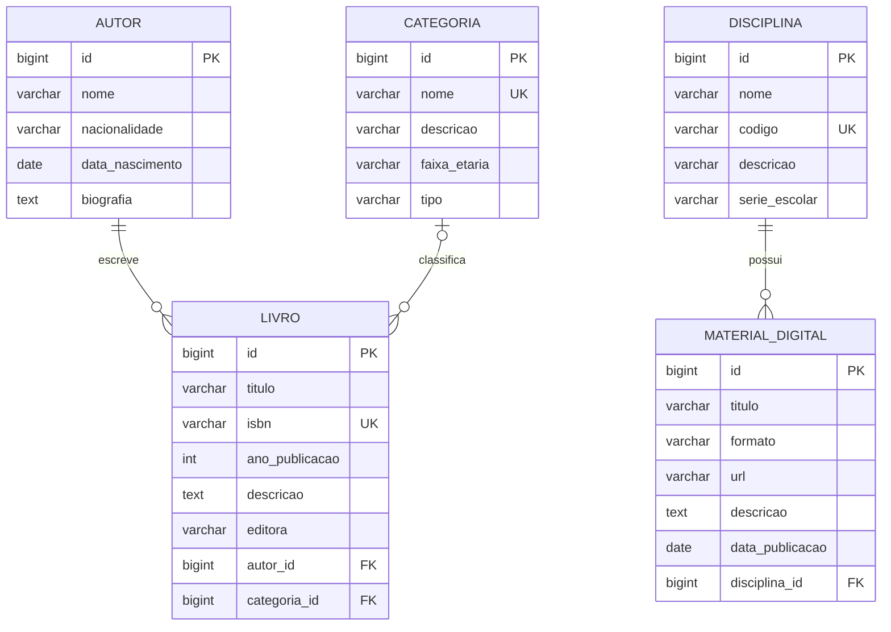

# Modelagem do ClassBook

> **Proposta inicial.** A modelagem abaixo **deve ser revisada em conjunto pelos dois integrantes antes da implementação** (Issues #3 e #4). Nenhuma entidade, tabela ou migration foi criada ainda.

## Entidades e atributos

Cada entidade tem pelo menos quatro atributos além do ID, como exige a disciplina. Chaves estrangeiras não entram nessa contagem.

Convenções: IDs `BIGINT` gerados pelo PostgreSQL (`GENERATED ALWAYS AS IDENTITY`); tabelas e colunas em `snake_case`, tabelas no singular.

### Autor (`autor`)

| Atributo | Tipo Java | Coluna | Regras propostas |
| --- | --- | --- | --- |
| id | Long | `id` | PK |
| nome | String | `nome VARCHAR(150)` | obrigatório |
| nacionalidade | String | `nacionalidade VARCHAR(80)` | opcional |
| dataNascimento | LocalDate | `data_nascimento DATE` | opcional; no passado |
| biografia | String | `biografia TEXT` | opcional |

Nome **não** é único (homônimos existem).

### Livro (`livro`)

| Atributo | Tipo Java | Coluna | Regras propostas |
| --- | --- | --- | --- |
| id | Long | `id` | PK |
| titulo | String | `titulo VARCHAR(200)` | obrigatório |
| isbn | String | `isbn VARCHAR(13)` | obrigatório, **único**, guardado só com dígitos (10 ou 13) |
| anoPublicacao | Integer | `ano_publicacao INTEGER` | opcional; não pode ser futuro |
| descricao | String | `descricao TEXT` | opcional |
| editora | String | `editora VARCHAR(120)` | opcional |
| autor | Autor | `autor_id BIGINT` | **obrigatório**, FK para `autor` |
| categoria | Categoria | `categoria_id BIGINT` | **opcional**, FK para `categoria` |

### Categoria (`categoria`)

| Atributo | Tipo Java | Coluna | Regras propostas |
| --- | --- | --- | --- |
| id | Long | `id` | PK |
| nome | String | `nome VARCHAR(100)` | obrigatório, **único** |
| descricao | String | `descricao VARCHAR(500)` | opcional |
| faixaEtaria | String | `faixa_etaria VARCHAR(30)` | opcional (ex.: "14 a 17 anos", "Livre") |
| tipo | String ou enum | `tipo VARCHAR(30)` | obrigatório; valores sugeridos: DIDATICO, PARADIDATICO, LITERATURA, REFERENCIA, OUTRO |

### Disciplina (`disciplina`)

| Atributo | Tipo Java | Coluna | Regras propostas |
| --- | --- | --- | --- |
| id | Long | `id` | PK |
| nome | String | `nome VARCHAR(100)` | obrigatório |
| codigo | String | `codigo VARCHAR(20)` | obrigatório, **único** |
| descricao | String | `descricao VARCHAR(500)` | opcional |
| serieEscolar | String ou enum | `serie_escolar VARCHAR(30)` | obrigatório (ex.: 1ª, 2ª ou 3ª série do ensino médio) |

### MaterialDigital (`material_digital`)

| Atributo | Tipo Java | Coluna | Regras propostas |
| --- | --- | --- | --- |
| id | Long | `id` | PK |
| titulo | String | `titulo VARCHAR(200)` | obrigatório |
| formato | String ou enum | `formato VARCHAR(20)` | obrigatório; valores sugeridos: PDF, EPUB, VIDEO, AUDIO, LINK, OUTRO |
| url | String | `url VARCHAR(500)` | obrigatório; URL http/https válida |
| descricao | String | `descricao TEXT` | opcional |
| dataPublicacao | LocalDate | `data_publicacao DATE` | opcional |
| disciplina | Disciplina | `disciplina_id BIGINT` | **obrigatório**, FK para `disciplina` |

## Relacionamentos

| Relação | Cardinalidade | Lado dono da FK | Exclusão |
| --- | --- | --- | --- |
| Livro → Autor | muitos para um | `livro.autor_id` | `ON DELETE RESTRICT` |
| Livro → Categoria | muitos para um (opcional) | `livro.categoria_id` | `ON DELETE RESTRICT` |
| MaterialDigital → Disciplina | muitos para um | `material_digital.disciplina_id` | `ON DELETE RESTRICT` |

Excluir um autor, categoria ou disciplina que ainda é referenciado deve responder **409 Conflict**, tratado no `service` e protegido pela FK no banco.

## Diagrama ER

## Justificativas das decisões

- **Relacionamentos unidirecionais, só no lado "muitos".** `Livro` conhece `Autor`, mas `Autor` não guarda uma lista de livros. Isso evita recursão infinita na serialização JSON, carregamentos desnecessários e código a mais. A consulta "livros de um autor" é feita por query no repositório.
- **`@ManyToOne(fetch = LAZY)`** em todas as associações, para não carregar dados que ninguém pediu.
- **DTOs na entrada e na saída.** As entidades nunca são expostas pela API. Sugestão: `XxxRequest` e `XxxResponse` como *records* Java, em `dto/`. As respostas de `Livro` trazem resumos aninhados (`autor: {id, nome}`, `categoria: {id, nome}`), e as de `MaterialDigital` trazem `disciplina: {id, nome}`.
- **Um autor por livro.** Atende ao requisito "relacionamento com Autor" com o menor custo. Coautoria exigiria a tabela `livro_autor`; fica como ponto em aberto.
- **Categoria opcional em Livro.** Reduz o acoplamento entre as duas frentes de trabalho: o CRUD de Livro funciona sem esperar o CRUD de Categoria. A associação é ligada na Issue #26, que depende explicitamente das Issues #30 e #31.
- **Schema só por Flyway.** A pasta `db/migration` é a fonte da verdade e o Hibernate roda com `ddl-auto=validate`. A migration inicial cria as cinco tabelas já revisadas; mudanças posteriores entram em novas migrations (ver [CONTRIBUTING](../CONTRIBUTING.md#migrations-flyway)).
- **Unicidade onde há regra de negócio:** ISBN, código da disciplina e nome da categoria. Nome de autor não, por haver homônimos.
- **Sem campos de auditoria** (data de criação, usuário) e sem vínculo direto entre `Livro` e `MaterialDigital`, para manter o escopo acadêmico e dentro dos requisitos.

## Contrato inicial da API (proposta)

Serve para o backend e a interface JavaFX avançarem em paralelo. Será refinado na Issue #4 e documentado no Swagger.

| Recurso | Rotas |
| --- | --- |
| Autor | `GET/POST /api/autores`, `GET/PUT/DELETE /api/autores/{id}` |
| Livro | `GET/POST /api/livros`, `GET/PUT/DELETE /api/livros/{id}` |
| Categoria | `GET/POST /api/categorias`, `GET/PUT/DELETE /api/categorias/{id}` |
| Disciplina | `GET/POST /api/disciplinas`, `GET/PUT/DELETE /api/disciplinas/{id}` |
| MaterialDigital | `GET/POST /api/materiais`, `GET/PUT/DELETE /api/materiais/{id}` |

- **Pesquisa avançada:** `GET /api/livros?titulo=&autorId=&categoriaId=` (filtros opcionais e combináveis).
- **Códigos HTTP:** `200` (consulta, edição), `201` com `Location` (cadastro), `204` (exclusão), `400` (dados inválidos), `404` (ID inexistente), `409` (duplicidade ou registro em uso).

## Pontos em aberto para a revisão conjunta

1. Um ou vários autores por livro?
2. Categoria obrigatória ou opcional em Livro?
3. ISBN obrigatório? Guardar com ou sem hífens?
4. `tipo`, `formato` e `serieEscolar` como texto livre validado ou como enum Java?
5. A busca por autor usa o ID, o nome ou ambos?
6. Nome de categoria único? Código de disciplina único?
