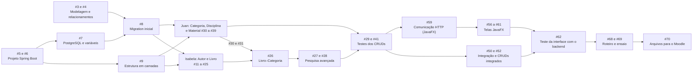

# Plano de trabalho

Este plano organiza o desenvolvimento do ClassBook em etapas, com responsáveis e dependências. **Não há datas**: prazos e datas de avaliação só serão registrados quando forem informados (Issue #94). A fonte de verdade do andamento é o GitHub Project **ClassBook — Planejamento e Desenvolvimento** e as Issues do repositório; cada Issue tem um marco (*milestone*) com o nome da etapa.

## Etapas

| Etapa (marco) | Campo "Etapa" no Project | Issues | Responsável principal |
| --- | --- | --- | --- |
| 1 — Planejamento e configuração | Planejamento | #1 a #10 | Compartilhada |
| 2 — CRUD de Autor e Livro | Backend | #11 a #29 | Isabela |
| 3 — CRUD de Categoria, Disciplina e MaterialDigital | Backend | #30 a #41 | Juan |
| 4 — Qualidade e integração | Qualidade | #42 a #53 e #71 a #75 (CI e GitHub Flow) | Ambos |
| 5 — Interface gráfica JavaFX | Interface | #54 a #62 | Isabela (catálogo e navegação) e Juan (formulários) |
| 6 — Entrega e apresentação | Entrega | #63 a #70 | Ambos |

## Responsabilidades

**Isabela Ohana (@isabelaohanadev):** CRUD de Autor e Livro, relacionamento Livro–Autor, pesquisa avançada de livros (título, autor, categoria), testes dessas rotas e regras de pesquisa, tela de catálogo e navegação da interface JavaFX.

**Juan Ribeiro (@JuanRiber):** CRUD de Categoria, Disciplina e MaterialDigital, relacionamento Material–Disciplina, testes das rotas e validações, formulários de cadastro e edição da interface JavaFX.

**Compartilhadas:** requisitos e modelagem, configuração do Spring Boot, banco e migrations, padronização da arquitetura, validações e tratamento global de erros, integração e revisão de código, Swagger, README e preparação da apresentação.

Cada Issue tem **um responsável principal**; o outro integrante é o revisor. Issues realmente conjuntas têm os dois como responsáveis. Todos devem fazer commits próprios e entender a arquitetura geral.

## Dependências principais

**Regras de paralelismo**

- Depois da modelagem (#3, #4), da migration inicial (#8) e da estrutura em camadas (#9), Isabela e Juan trabalham **em paralelo**, cada um em suas branches (`feature/crud-autor`, `feature/crud-livro`, `feature/crud-categoria`, `feature/crud-disciplina`, `feature/crud-material-digital`, `feature/pesquisa-avancada`).
- O único ponto de sincronização do backend é o relacionamento **Livro–Categoria (#26)**, que depende de #30 e #31. Para não travar a frente de Autor e Livro, Juan começa pelo CRUD de Categoria.
- A estrutura da interface (#54, #55) pode começar cedo. A comunicação HTTP (#59) e as telas que dependem de endpoints esperam os CRUDs correspondentes estarem testados.
- Validações, tratamento global de erros e Swagger (#42 a #48) avançam junto com os CRUDs, sem esperar que todos terminem.
- O CI (#71) e o GitHub Flow (#73) existem antes das revisões de código em PR (#51).

## Ordem sugerida de execução

Da primeira à última tarefa, respeitando todas as dependências. É a mesma ordem do campo **Ordem** no GitHub Project, onde a visualização "Todas as tarefas" já aparece nessa sequência. A numeração das Issues segue a lista original do escopo e não muda; use esta tabela (ou o Project) para saber o que fazer primeiro.

- Tarefas de responsáveis diferentes que aparecem seguidas, **e cujas dependências já estejam concluídas, podem ser feitas ao mesmo tempo**. Depois da migration inicial (#8) e da estrutura em camadas (#9), Juan e Isabela seguem em paralelo.
- A Categoria (#30 e #31) sobe na fila porque desbloqueia o relacionamento Livro–Categoria (#26) da Isabela.
- A revisão de código em PRs (#51) é contínua: começa no primeiro PR e só é encerrada no fim.
- As tarefas de CI (#71 a #75) vêm logo depois da Etapa 1, para que todo PR já passe pelo pipeline.

| Ordem | Issue | Tarefa | Responsável | Depende de |
| ---: | --- | --- | --- | --- |
| 1 | #1 | Criar e configurar o repositório | Isabela | — |
| 2 | #2 | Definir os requisitos funcionais e não funcionais | Juan | #1 |
| 3 | #3 | Revisar a modelagem das cinco entidades | Ambos | #2 |
| 4 | #4 | Definir os relacionamentos entre as entidades | Ambos | #3 |
| 5 | #5 | Criar o projeto Spring Boot com Maven | Isabela | #1 |
| 6 | #6 | Configurar Java e dependências | Juan | #5 |
| 7 | #7 | Configurar PostgreSQL e variáveis de ambiente | Juan | #6 |
| 8 | #8 | Configurar Flyway e a migration inicial | Isabela | #3, #4, #7 |
| 9 | #9 | Criar a estrutura Model, DTO, Repository, Service e Controller | Isabela | #5, #6 |
| 10 | #10 | Documentar as instruções iniciais de execução | Juan | #5, #7 |
| 11 | #71 | Criar o workflow básico de CI com GitHub Actions | Isabela | #5 |
| 12 | #72 | Validar compilação e testes no pipeline | Juan | #71 |
| 13 | #73 | Documentar o GitHub Flow no CONTRIBUTING.md | Isabela | #1 |
| 14 | #74 | Configurar as regras de proteção da main, se disponíveis | Isabela | #71 |
| 15 | #51 | Revisar o código em pull requests | Ambos | #71, #73 |
| 16 | #75 | Testar o CI com um pull request real | Ambos | #71, #73 |
| 17 | #30 | Criar a entidade Categoria e seu DTO | Juan | #8, #9 |
| 18 | #31 | Criar CategoriaRepository, CategoriaService e CategoriaController | Juan | #30 |
| 19 | #11 | Criar a entidade Autor e seu DTO | Isabela | #8, #9 |
| 20 | #12 | Criar AutorRepository | Isabela | #11 |
| 21 | #13 | Implementar AutorService | Isabela | #11, #12 |
| 22 | #14 | Implementar AutorController | Isabela | #13 |
| 23 | #15 | Implementar cadastro de autor | Isabela | #14 |
| 24 | #16 | Implementar listagem de autores | Isabela | #14 |
| 25 | #17 | Implementar consulta de autor por ID | Isabela | #14 |
| 26 | #18 | Implementar edição de autor | Isabela | #14 |
| 27 | #19 | Implementar exclusão de autor | Isabela | #14 |
| 28 | #20 | Criar a entidade Livro e seu DTO | Isabela | #8, #9, #11 |
| 29 | #21 | Criar LivroRepository | Isabela | #20 |
| 30 | #22 | Implementar LivroService | Isabela | #21, #12 |
| 31 | #23 | Implementar LivroController | Isabela | #22 |
| 32 | #24 | Implementar as cinco operações do CRUD de Livro | Isabela | #23 |
| 33 | #25 | Configurar e testar o relacionamento entre Livro e Autor | Isabela | #24, #13 |
| 34 | #26 | Configurar o relacionamento entre Livro e Categoria | Isabela | #24, #30, #31 |
| 35 | #27 | Implementar pesquisa de livros por título | Isabela | #24 |
| 36 | #28 | Implementar filtros por autor e categoria | Isabela | #25, #26, #27 |
| 37 | #29 | Criar testes das rotas e das regras de pesquisa | Isabela | #25, #26, #27, #28 |
| 38 | #32 | Implementar as cinco operações do CRUD de Categoria | Juan | #31 |
| 39 | #33 | Criar a entidade Disciplina e seu DTO | Juan | #8, #9 |
| 40 | #34 | Criar DisciplinaRepository, DisciplinaService e DisciplinaController | Juan | #33 |
| 41 | #35 | Implementar as cinco operações do CRUD de Disciplina | Juan | #34 |
| 42 | #36 | Criar a entidade MaterialDigital e seu DTO | Juan | #8, #9, #33 |
| 43 | #37 | Criar MaterialDigitalRepository, MaterialDigitalService e MaterialDigitalController | Juan | #36, #34 |
| 44 | #38 | Implementar as cinco operações do CRUD de MaterialDigital | Juan | #37 |
| 45 | #39 | Configurar e testar o relacionamento entre MaterialDigital e Disciplina | Juan | #35, #38 |
| 46 | #40 | Validar os endpoints e as regras de negócio | Juan | #32, #35, #39 |
| 47 | #41 | Criar testes das rotas e das validações | Juan | #40 |
| 48 | #42 | Implementar validações de entrada usando Bean Validation | Juan | #11, #20, #30, #33, #36 |
| 49 | #43 | Implementar tratamento global de exceções | Juan | #9 |
| 50 | #44 | Padronizar mensagens de erro e códigos HTTP | Juan | #43 |
| 51 | #45 | Tratar IDs inexistentes e relacionamentos inválidos | Isabela | #43, #25, #26, #39 |
| 52 | #46 | Avaliar e tratar duplicidades relevantes, como ISBN | Isabela | #43, #24 |
| 53 | #47 | Configurar documentação Swagger/OpenAPI | Juan | #6, #9 |
| 54 | #48 | Documentar e testar todas as rotas | Ambos | #47, #29, #41, #44 |
| 55 | #49 | Testar a execução das migrations em um banco vazio | Juan | #8, #26, #39 |
| 56 | #50 | Integrar as branches dos dois integrantes | Ambos | #29, #41 |
| 57 | #52 | Testar os cinco CRUDs integrados | Ambos | #50, #44, #45, #46 |
| 58 | #53 | Verificar se o README permite configurar e executar o projeto | Isabela | #10, #47, #49 |
| 59 | #54 | Definir a estrutura da aplicação JavaFX | Isabela | #3, #4, #6 |
| 60 | #55 | Criar a tela principal e a navegação | Isabela | #54 |
| 61 | #59 | Implementar a comunicação HTTP com a API | Juan | #54, #29, #41 |
| 62 | #56 | Criar a tela de catálogo de livros | Isabela | #55, #59, #24 |
| 63 | #57 | Implementar a busca e os filtros na interface | Isabela | #56, #28 |
| 64 | #58 | Criar formulários de cadastro e edição | Juan | #55, #59, #15, #18, #24, #32, #35, #38 |
| 65 | #60 | Exibir detalhes dos livros e links dos materiais digitais | Isabela | #56, #38 |
| 66 | #61 | Exibir mensagens de sucesso e de erro | Juan | #59, #44 |
| 67 | #62 | Testar a interface com o backend integrado | Ambos | #52, #57, #58, #60, #61 |
| 68 | #63 | Revisar o README e as instruções de execução | Juan | #53, #62 |
| 69 | #64 | Documentar as contribuições individuais | Ambos | #62 |
| 70 | #65 | Registrar o uso de ferramentas de IA | Ambos | #62 |
| 71 | #66 | Verificar os commits e pull requests de cada integrante | Ambos | #64 |
| 72 | #67 | Testar a aplicação em ambiente limpo | Juan | #63, #62 |
| 73 | #68 | Preparar o roteiro da apresentação de até 10 minutos | Ambos | #52, #62 |
| 74 | #69 | Preparar cada integrante para perguntas individuais | Ambos | #68, #66 |
| 75 | #70 | Conferir os arquivos necessários para a entrega no Moodle | Isabela | #63, #67, #69 |

## Critérios de conclusão

**Por Issue** (definição de pronto):

1. Todos os critérios de aceitação da Issue foram atendidos.
2. Código integrado na `main` por PR, com CI verde e aprovação do outro integrante.
3. Testes automatizados quando houver comportamento novo; migrations sem editar arquivos já integrados.
4. Documentação atualizada, se necessário (README, Swagger, `docs/`).
5. A Issue é fechada pelo PR (`Closes #N`) e movida para **Concluído** no Project.

**Por etapa:** todas as Issues da etapa concluídas e verificadas.

**Do projeto:** os cinco CRUDs funcionam integrados; a pesquisa avançada funciona; as migrations rodam em banco vazio; o README permite configurar e executar; a interface JavaFX usa a API; o CI está verde na `main`; a apresentação está ensaiada; os arquivos de entrega estão conferidos.

## Informações pendentes (não inventar)

- Datas de entrega, de avaliação e do acompanhamento semanal: o enunciado não as traz; o registro é acompanhado na Issue #94.
- Acesso do professor ao Project. O enunciado exige só o acesso ao repositório, que é público (conferido na Issue #78).
- Permanência da interface JavaFX no escopo, que o enunciado não exige: Issue #93.
- Regras de proteção da `main`: o estado real de ativação é acompanhado na Issue #74.
