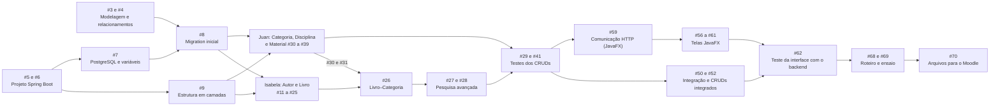

# Plano de trabalho

Este plano organiza o desenvolvimento do ClassBook em etapas, com responsáveis e dependências. **Não há datas**: prazos e datas de avaliação só serão registrados quando forem informados. A fonte de verdade do andamento é o GitHub Project **ClassBook — Planejamento e Desenvolvimento** e as Issues do repositório; cada Issue tem um marco (*milestone*) com o nome da etapa.

## Etapas

| Etapa (marco) | Campo "Etapa" no Project | Issues | Responsável principal |
| --- | --- | --- | --- |
| 1 — Planejamento e configuração | Planejamento | #1 a #10 | Compartilhada |
| 2 — CRUD de Autor e Livro | Backend | #11 a #29 | Isabela |
| 3 — CRUD de Categoria, Disciplina e MaterialDigital | Backend | #30 a #41 | Juan |
| 4 — Qualidade e integração | Qualidade | #42 a #53 e #71 a #75 (CI e GitHub Flow) | Ambos |
| 5 — Interface gráfica JavaFX | Interface | #54 a #62 | Isabela (catálogo e navegação) e Juan (formulários) |
| 6 — Entrega e apresentação | Entrega | #63 a #70 | Ambos |

## Responsabilidades

**Isabela Ohana (@isabelaohanadev):** CRUD de Autor e Livro, relacionamento Livro–Autor, pesquisa avançada de livros (título, autor, categoria), testes dessas rotas e regras de pesquisa, tela de catálogo e navegação da interface JavaFX.

**Juan Ribeiro (@JuanRiber):** CRUD de Categoria, Disciplina e MaterialDigital, relacionamento Material–Disciplina, testes das rotas e validações, formulários de cadastro e edição da interface JavaFX.

**Compartilhadas:** requisitos e modelagem, configuração do Spring Boot, banco e migrations, padronização da arquitetura, validações e tratamento global de erros, integração e revisão de código, Swagger, README e preparação da apresentação.

Cada Issue tem **um responsável principal**; o outro integrante é o revisor. Issues realmente conjuntas têm os dois como responsáveis. Todos devem fazer commits próprios e entender a arquitetura geral.

## Dependências principais

**Regras de paralelismo**

- Depois da modelagem (#3, #4), da migration inicial (#8) e da estrutura em camadas (#9), Isabela e Juan trabalham **em paralelo**, cada um em suas branches (`feature/crud-autor`, `feature/crud-livro`, `feature/crud-categoria`, `feature/crud-disciplina`, `feature/crud-material-digital`, `feature/pesquisa-avancada`).
- O único ponto de sincronização do backend é o relacionamento **Livro–Categoria (#26)**, que depende de #30 e #31. Para não travar a frente de Autor e Livro, Juan começa pelo CRUD de Categoria.
- A estrutura da interface (#54, #55) pode começar cedo. A comunicação HTTP (#59) e as telas que dependem de endpoints esperam os CRUDs correspondentes estarem testados.
- Validações, tratamento global de erros e Swagger (#42 a #48) avançam junto com os CRUDs, sem esperar que todos terminem.
- O CI (#71) e o GitHub Flow (#73) existem antes das revisões de código em PR (#51).

## Critérios de conclusão

**Por Issue** (definição de pronto):

1. Todos os critérios de aceitação da Issue foram atendidos.
2. Código integrado na `main` por PR, com CI verde e aprovação do outro integrante.
3. Testes automatizados quando houver comportamento novo; migrations sem editar arquivos já integrados.
4. Documentação atualizada, se necessário (README, Swagger, `docs/`).
5. A Issue é fechada pelo PR (`Closes #N`) e movida para **Concluído** no Project.

**Por etapa:** todas as Issues da etapa concluídas e verificadas.

**Do projeto:** os cinco CRUDs funcionam integrados; a pesquisa avançada funciona; as migrations rodam em banco vazio; o README permite configurar e executar; a interface JavaFX usa a API; o CI está verde na `main`; a apresentação está ensaiada; os arquivos de entrega estão conferidos.

## Informações pendentes (não inventar)

- Datas de entrega e de avaliação.
- Licença do repositório (os integrantes ainda não escolheram).
- Como e quando o professor terá acesso ao repositório e ao Project.
- Regras de proteção da `main`: dependem do plano da conta (Issue #74).
